# Antigravity Fonts ⚡

An ultra-lightweight, high-performance desktop application written in **Rust** designed to search, preview, and automatically install Google Fonts onto Windows without manual downloading, ZIP extraction, or administrator prompts.

The interface is inspired by the **[Google Antigravity](https://antigravity.google)** design language: cosmic dark surfaces, electric cyan & indigo accents, crisp pill badges, and real-time responsiveness.

---

## ✨ Features

- **Ultra-Lightweight & Fast**: Compiled native binary is only **~7.6 MB** with an instant startup time (<50 ms) and minimal RAM usage (~30 MB).
- **1,950+ Google Fonts Directory**: Instant offline-cached catalog with real-time keystroke filtering across family names, categories, and styles.
- **1-Click Silent Installation (Zero UAC/Admin)**:
  - Automatically extracts TTF font variants into `%LOCALAPPDATA%\Microsoft\Windows\Fonts`.
  - Registers fonts in `HKCU\Software\Microsoft\Windows NT\CurrentVersion\Fonts`.
  - Broadcasts `WM_FONTCHANGE` system-wide—instantly usable across all running apps (Figma, VS Code, Photoshop, browsers) without rebooting.
- **Antigravity UI Design**:
  - Cosmic obsidian dark canvas (`#0A0B10`) & sleek elevated card containers (`#141721`).
  - Antigravity iridescent gradient accent dividing line (cyan `#38BDF8` to violet `#A855F7`).
  - Smooth 60 FPS micro-interactions: card hover illumination, pulsating installation states, and floating HUD toast alerts.
  - 1-click **`📋 CSS`** snippet export (`font-family: '...';`) and **`↗ Web`** direct Google Fonts specimen inspector.
  - Responsive overflow-proof card headers and horizontal category carousel.
  - Editable live typography preview bar with adjustable font size slider and quick presets (`Aa`, `123`, `Caps`, `Pangram`).

---

## 🛠️ Architecture & Tech Stack

```mermaid
flowchart LR
    CatalogAPI["Google Fonts API / GWFH"] -->|Fetch 1,950+ Families| CatalogService[Local JSON Cache]
    CatalogService --> UI["egui / eframe Antigravity Engine"]
    UI -->|Click Install| Worker[Tokio Async Downloader]
    Worker --> Extractor[ZIP Archive Extractor]
    Extractor --> FontsDir["%LOCALAPPDATA%/Microsoft/Windows/Fonts"]
    FontsDir --> WinReg["Windows Registry HKCU"]
    WinReg --> Broadcast["Win32 WM_FONTCHANGE"]
```



| Layer | Technology |
| :--- | :--- |
| **Language** | Rust 2021 |
| **GUI Engine** | `egui` 0.31 / `eframe` (Native GPU accelerated via Glow) |
| **Async Runtime** | `tokio` (Multi-thread runtime on dedicated worker) |
| **Network** | `reqwest` (Rustls TLS, zero OpenSSL dependencies) |
| **Font Extraction** | `zip` + `ttf-parser` (Metadata extraction) |
| **OS Integration** | `winreg` + `windows-sys` (Per-user registry & Win32 broadcast) |

---

## 🚀 Getting Started

### Prerequisites

- [Rust & Cargo](https://rustup.rs/) (1.80+)

### Building from Source

```powershell
# Clone or navigate to the directory
cd C:\Users\armon\DEV\antigravity-fonts

# Run debug build
cargo run

# Build optimized release binary
cargo build --release
```

The optimized executable will be located at:
```
target/release/antigravity-fonts.exe
```

---

## 💻 Usage

1. Launch `antigravity-fonts.exe`.
2. Browse or type any font name in the search bar (e.g. `Inter`, `Roboto`, `Space Grotesk`, `Playfair`).
3. Click any category pill to filter styles (`Sans-serif`, `Serif`, `Monospace`, etc.) or see already installed fonts under `Installed`.
4. Customize the preview text and font size at the top toolbar to inspect the typography.
5. Click **↓ Install Font** on any family card. The app will download, extract, register, and broadcast the font in a fraction of a second.
