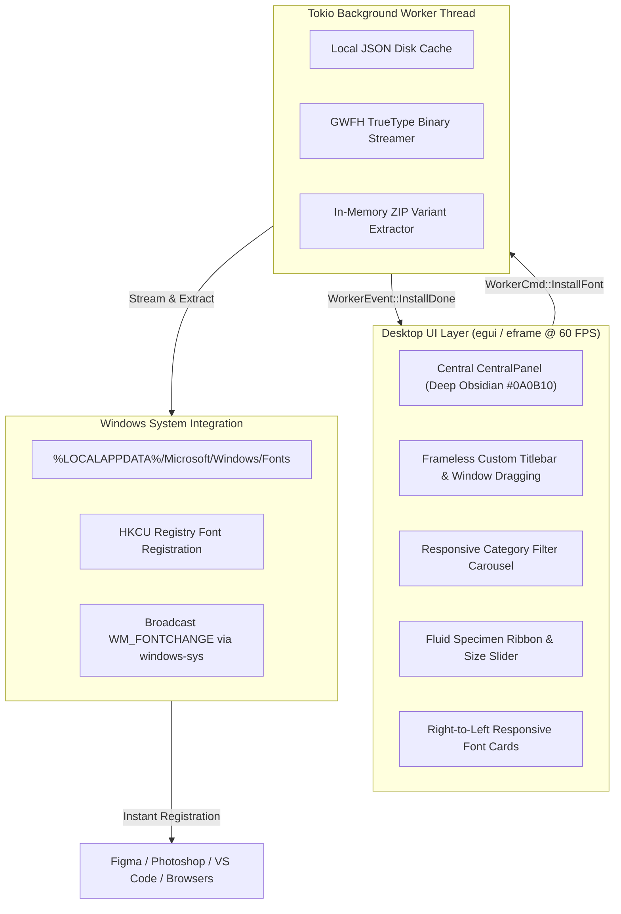

<div align="center">

# Glyphr ⚡
### The Google Fonts Desktop Engine for Windows

[](https://github.com/armoniapush/glyphr/releases)
[](https://github.com/armoniapush/glyphr)
[](https://www.rust-lang.org/)
[](https://github.com/armoniapush/glyphr/releases)
[](LICENSE)

<br/>

**Glyphr** is an ultra-lightweight, high-performance desktop typography engine written in **Rust**. It eliminates the manual friction of browsing, downloading ZIP files, extracting archives, and approving UAC admin prompts just to install fonts on Windows.

Browse 1,960+ Google Fonts, preview them with real-time TrueType rendering on the GPU, and install entire font families into Windows in **<200 ms** with a single click.

[**⬇️ Download Glyphr (Windows x64)**](https://github.com/armoniapush/glyphr/releases/latest) • [Features](#-key-features) • [Architecture](#-architecture) • [Building](#-building-from-source)

</div>

---

## ⚡ The Problem vs The Glyphr Way

| Task | Traditional Font Installation | With Glyphr ⚡ |
| :--- | :--- | :--- |
| **Discovery** | Heavy browser tabs, bloated DOM | Instant keystroke search (<5 ms) across 1,960+ families |
| **Download** | Manual ZIP download to `Downloads/` | Zero files saved to Downloads; streams directly in memory |
| **Extraction** | Manual archive extraction | Automated multi-thread ZIP extraction via Tokio |
| **Permissions** | Windows UAC elevation prompt required | **Zero UAC/admin prompts** (installs to `%LOCALAPPDATA%`) |
| **System Sync** | Must reboot or restart apps to detect fonts | Broadcasts `WM_FONTCHANGE` instantly to Figma, Photoshop & VS Code |
| **Speed** | 45–90 seconds per font family | **< 200 milliseconds** per font family |

---

## ✨ Key Features

### 🚀 1-Click Silent Windows Font Engine
- Installs all font variants (`Regular`, `Bold`, `Italic`, `Light`, etc.) into `%LOCALAPPDATA%\Microsoft\Windows\Fonts`.
- Registers font entries in `HKCU\Software\Microsoft\Windows NT\CurrentVersion\Fonts`.
- Broadcasts the Win32 `WM_FONTCHANGE` message system-wide. Applications like **Figma, Adobe Creative Cloud, VS Code, and Chrome** detect newly installed fonts immediately without restarting.

### 🎨 Deep Obsidian & Material Design 3 Dark Theme
- **Cosmic Obsidian Canvas** (`#0A0B10` void to `#141721` cards) designed for pro-grade dark environments.
- **Antigravity Iridescent Accent**: Luminous gradient dividing line flowing from electric cyan (`#38BDF8`) to violet (`#A855F7`).
- **60 FPS Micro-Interactions**: Smooth card hover elevation, animated border illumination, real-time oscillating pulse loaders during background downloads, and floating HUD toast alerts.

### 🔍 Instant Keystroke Catalog & Responsive Carousel
- Local cache allows **0 ms startup time** with full offline catalog availability.
- Dynamic filtering across family name, ID, category (`Sans-serif`, `Serif`, `Display`, `Handwriting`, `Monospace`), and currently installed fonts.
- **Horizontal Category Carousel**: Filter chips sit in a responsive horizontal scroll track that never clips or distorts on compact displays.

### ✍️ Real TrueType Typographic Preview
- Unlike web views or raster approximations, Glyphr parses genuine `.ttf` binaries in memory using `ttf-parser` and promotes them into the GPU font atlas.
- Interactive specimen ribbon with responsive font-size slider (`16px` – `56px`) and instant preset toggles:
  - `Aa` — Alphabet (*The quick brown fox jumps over the lazy dog*)
  - `123` — Numerics & Symbols (*0123456789 !@#$%^&*()*)
  - `Caps` — Uppercase Specimen (*DANIEL DOBLES*)
  - `Pangram` — Typography Test (*Sphinx of black quartz, judge my vow*)

### 📋 Developer & Designer Quick Tools
- **`📋 CSS`**: 1-click copies the exact CSS `font-family` declaration directly to the Windows clipboard (e.g., `font-family: 'Poppins', sans-serif;`) with floating HUD feedback.
- **`↗ Web`**: 1-click opens the official Google Fonts specimen page to inspect full glyph tables, licensing, and designer bios.

---

## 🛠️ Architecture



---

## 📦 Tech Stack

| Layer | Technology | Details |
| :--- | :--- | :--- |
| **Language** | [Rust 2021](https://www.rust-lang.org/) | Memory-safe, zero garbage collection, maximum CPU performance |
| **GUI Framework** | [`egui`](https://github.com/emilk/egui) & [`eframe`](https://github.com/emilk/egui/tree/master/crates/eframe) 0.31 | Immediate-mode GPU rendering via Glow / OpenGL |
| **Async Runtime** | [`tokio`](https://tokio.rs/) 1.43 | Dedicated multi-threaded worker thread for non-blocking I/O |
| **HTTP Client** | [`reqwest`](https://github.com/seanmonstar/reqwest) 0.12 | Rustls TLS (zero external OpenSSL / dynamic C runtime dependencies) |
| **Font Parser** | [`ttf-parser`](https://github.com/RazrFalcon/ttf-parser) 0.25 | Safe zero-allocation TrueType font binary header extraction |
| **Archive Decompression** | [`zip`](https://github.com/zip-rs/zip2) 2.2 | High-throughput streaming deflate decompressor |
| **Windows Registry** | [`winreg`](https://github.com/gentoo90/winreg-rs) 0.52 | Per-user non-elevated font key manipulation |
| **Win32 Messaging** | [`windows-sys`](https://github.com/microsoft/windows-rs) 0.59 | Raw Win32 API binding for `WM_FONTCHANGE` broadcast |

---

## 🚀 Getting Started

### Option 1: Direct Download (Precompiled Binary)
1. Head to the **[Releases](https://github.com/armoniapush/glyphr/releases/latest)** page.
2. Download **`glyphr.exe`** (~7.8 MB).
3. Run the executable anywhere—no installation wizard or runtime prerequisites required.

### Option 2: Building from Source

#### Prerequisites
- [Rust & Cargo](https://rustup.rs/) (v1.80+)
- Windows 10 / 11

```powershell
# 1. Clone the repository
git clone https://github.com/armoniapush/glyphr.git
cd glyphr

# 2. Run in debug mode with hot reloading
cargo run

# 3. Build optimized release binary
cargo build --release
```

The compiled release executable will be available at:
```
target/release/glyphr.exe
```

---

## ⌨️ Shortcuts & Navigation

| Action | Control |
| :--- | :--- |
| **Move Window** | Click and drag anywhere on the custom top title bar |
| **Maximize / Restore** | Double-click the title bar or click the `□` button |
| **Minimize to Taskbar** | Click the `—` button |
| **Close Application** | Click the `✕` button |
| **Live Search** | Focus the search input and type any font name or style |
| **Clear Search** | Click the `✕` inside the search pill |
| **Copy CSS Declaration** | Click the `📋 CSS` button on any font card |
| **Web Specimen** | Click `↗ Web` on any font card to open Google Fonts in your browser |
| **Adjust Preview Size** | Drag the slider in the Specimen Ribbon (`16px` to `56px`) |

---

## 📄 License

This project is licensed under the [MIT License](LICENSE).

Fonts installed through Glyphr are subject to their respective open-source licenses (SIL Open Font License, Apache 2.0, or Ubuntu Font License) as distributed by Google Fonts.
